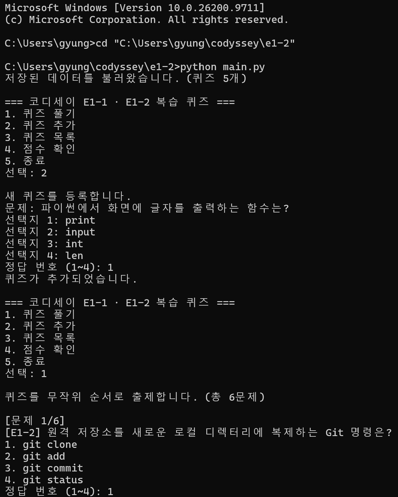
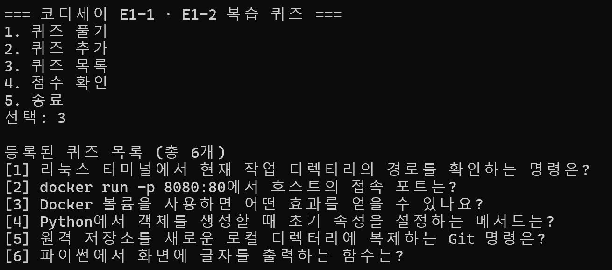
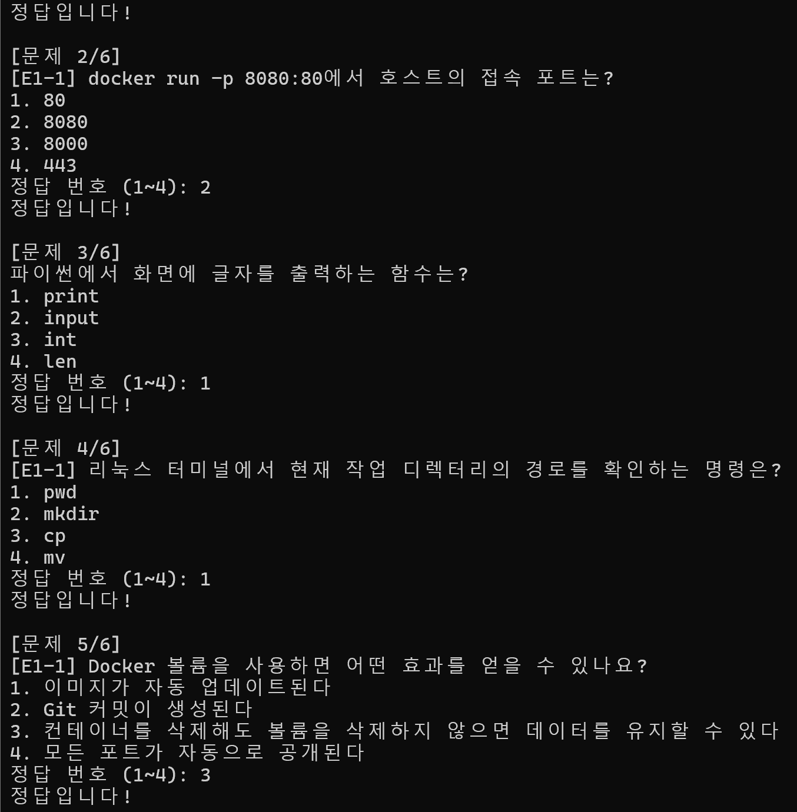
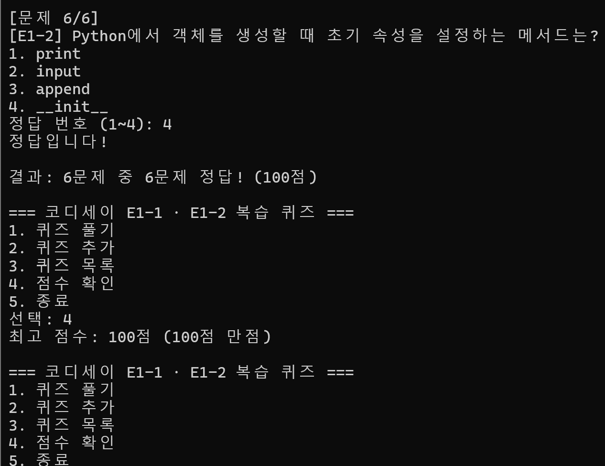
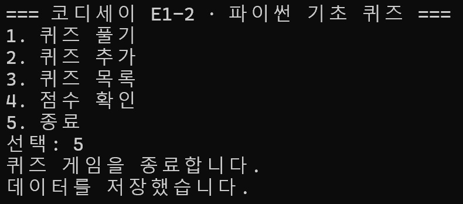
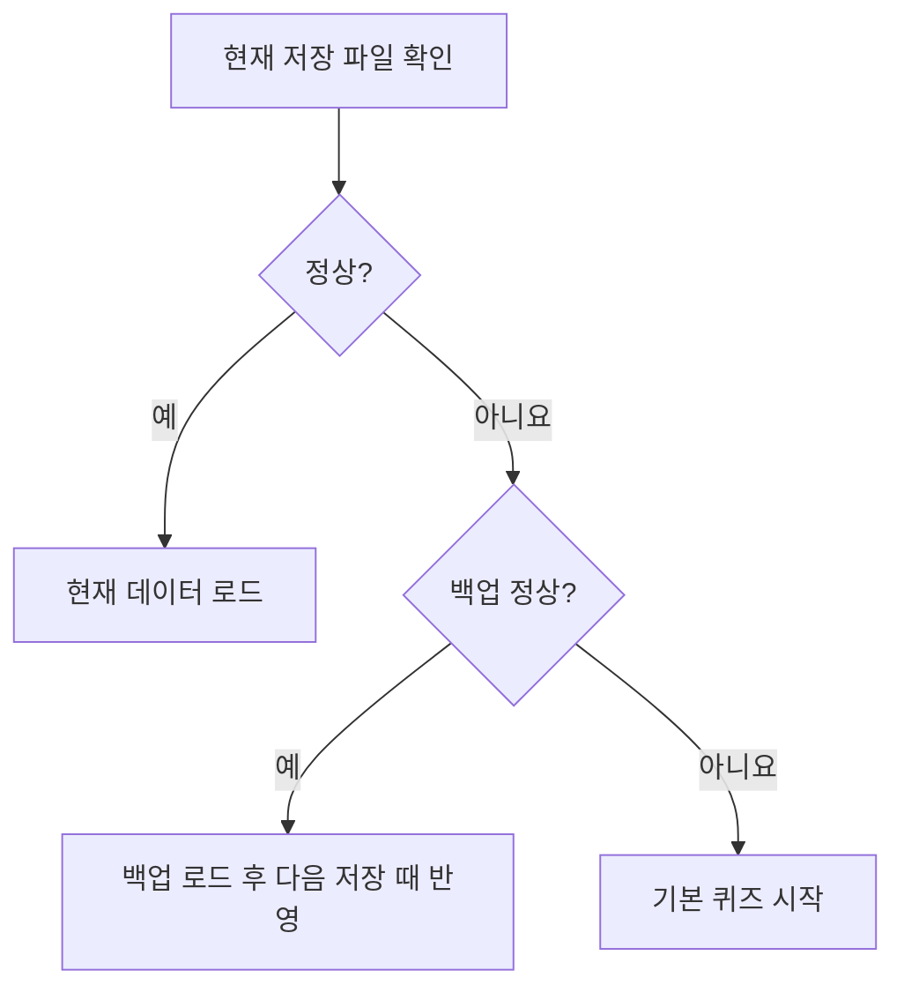
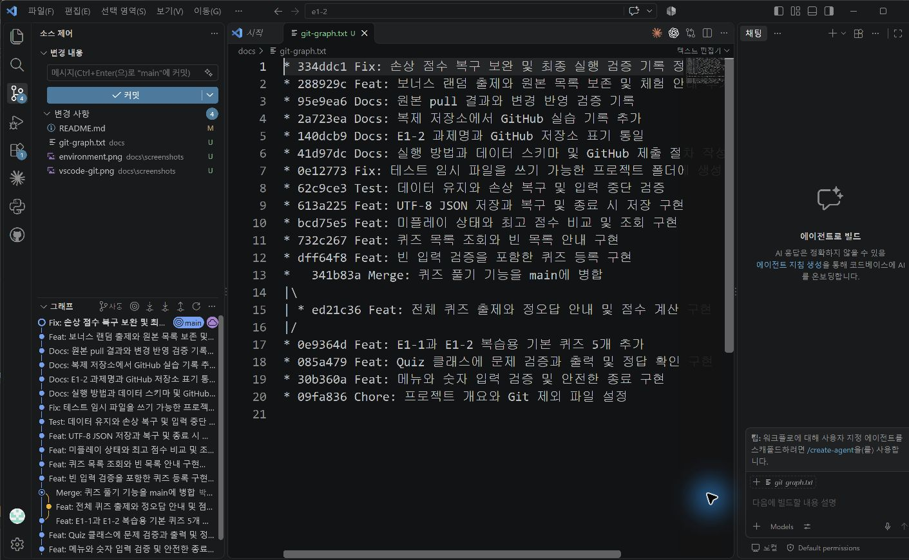

# 코디세이 E1-2 — Python 콘솔 퀴즈 게임

코디세이 입학연수 E1-2 「컴퓨터에게 명령 내리는 말(파이썬) 처음 배우기」 과제입니다.
파이썬 기초를 복습하는 콘솔 퀴즈 게임입니다.

- GitHub 저장소: [codyssey-E1-2-quiz-game](https://github.com/gyungmini306-blip/codyssey-E1-2-quiz-game)
- 이전 과제: [E1-1 개발 워크스테이션](https://github.com/gyungmini306-blip/codyssey-E1-1-dev-workstation)

## 실행 방법

프로젝트 폴더에서 다음 명령을 실행합니다.

```shell
python main.py
```

Windows에서 `python` 명령이 없다면 `py main.py`를 사용합니다.
외부 패키지 설치는 필요하지 않습니다.

## 주제 선정 이유

입력과 자료형, 반복문, 함수, 클래스처럼 이 게임을 구현하는 데 사용한 파이썬 기초를 문제로 풀며 복습할 수 있도록 이 주제를 선택했습니다.

## 개발 환경

- Python 3.10 이상
- Python 표준 라이브러리만 사용
- 실제 확인 환경: Windows / PowerShell / Python 3.13.3 / Git 2.52.0.windows.1

개발 환경 캡처는 이 절에 추가합니다.

## 기능 목록

1. 퀴즈 풀기: 전체 문제를 무작위 순서로 출제하고 정오답과 최종 점수를 표시합니다.
2. 퀴즈 추가: 문제, 선택지 4개, 정답 번호 1~4를 입력하여 등록합니다.
3. 퀴즈 목록: 등록된 문제의 제목을 확인합니다.
4. 점수 확인: 완료한 게임의 최고 점수를 확인합니다.
5. 종료: 데이터 저장을 시도한 뒤 종료합니다.

숫자 입력은 앞뒤 공백을 제거하며, 빈 입력·문자·범위 밖 숫자는 다시 입력받습니다.
문제와 선택지는 빈 내용을 등록할 수 없습니다.
Ctrl+C 또는 입력 스트림 종료 시 안내 후 저장을 시도합니다.
입력 도중 중단된 새 문제는 등록하지 않으며, 미완료 게임은 점수에 반영하지 않습니다.

## 기본 문제

파이썬 기초 문제 5개를 제공합니다. 입력과 자료형, 반복 범위, 반환값, 객체 초기화, 딕셔너리 키를 다룹니다. 문제를 바꾸려면 `defaults.py`와 이 설명을 함께 수정하세요. 이미 저장한 데이터는 실행 시 기본 문제보다 우선합니다.


## 보너스 과제: 랜덤 출제

게임을 시작할 때마다 Python 표준 라이브러리 `random`의 `shuffle()`로 문제 순서를 섞습니다.
`self.quizzes.copy()`로 만든 목록을 섞으므로 퀴즈 목록과 저장 파일의 등록 순서는 유지합니다.
선택지와 정답 번호는 바뀌지 않으며, 모든 문제를 한 번씩 출제합니다.
무작위이므로 이전 게임과 같은 순서가 나올 수도 있습니다.


**코드 · QuizGame.play()의 랜덤 출제**

```python
questions = self.quizzes.copy()
random.shuffle(questions)
total = len(questions)
print(f"\n퀴즈를 무작위 순서로 출제합니다. (총 {total}문제)")
for number, quiz in enumerate(questions, start=1):
    print(f"\n[문제 {number}/{total}]")
    quiz.display()
```

`copy()`는 이번 출제에 쓸 별도 리스트를 만듭니다. `random.shuffle(questions)`는 그 리스트의 순서를 바꿉니다. 아래 `for`가 `self.quizzes` 대신 `questions`를 순회하므로 출제 순서만 바뀌고 등록 목록 순서는 유지됩니다.

## 직접 체험하기

프로젝트 폴더에서 `python main.py`를 실행하고 원하는 기능의 번호를 입력합니다. 아래 사진은 기능별 실행 예시입니다.

### 퀴즈 추가 (2)

문제, 선택지 네 개, 정답 번호를 입력합니다. 이 화면에서는 리스트 끝에 항목을 추가하는 메서드를 묻는 문제를 등록했습니다.



**코드 · QuizGame.add_quiz()**

```python
question = read_text("문제: ")
choices = []
for number in range(1, 5):
    choices.append(read_text(f"선택지 {number}: "))
answer = read_number("정답 번호 (1~4): ", 1, 4)
self.quizzes.append(Quiz(question, choices, answer))
print("퀴즈가 추가되었습니다.")
self.save_state()
```

문제와 선택지 네 개, 정답 번호를 모두 받은 뒤 `Quiz` 객체를 목록에 추가하고 저장합니다. 입력 중간에 취소하면 목록에 추가하는 줄까지 도달하지 않습니다.


### 퀴즈 목록 (3)

등록된 문제의 개수와 제목을 확인합니다. 아래는 기본 문제 5개와 화면 출력 함수를 묻는 추가 문제 1개가 등록됐을 때의 화면입니다.



**코드 · QuizGame.list_quizzes()**

```python
for number, quiz in enumerate(self.quizzes, start=1):
    print(f"[{number}] {quiz.question}")
```

`enumerate(..., start=1)`로 각 문제에 1부터 번호를 붙이고 제목을 출력합니다.


### 퀴즈 풀이 (1)

1~4 중 답을 선택하면 정오답을 안내합니다. 아래 게임에서는 6문제 중 5문제를 맞혀 **83.33점**을 받았습니다.



**코드 · QuizGame.play()의 정답 판정**

```python
answer = read_number("정답 번호 (1~4): ", 1, 4)
if quiz.is_correct(answer):
    print("정답입니다!")
    correct += 1
```

입력 함수가 반환한 정수로 정답을 비교하고, 맞힌 경우 정답 수를 1 증가시킵니다. 마지막에 정답 수를 전체 문제 수로 나눠 100점 만점으로 환산합니다.


### 최고 점수 확인 (4)

완료한 게임 중 가장 높은 점수를 보여줍니다. 아래의 **100점**은 저장된 최고 기록입니다. 완료 기록이 없으면 미플레이 안내가 나옵니다.



**코드 · QuizGame.show_score()**

```python
if self.best_score is None:
    print("아직 완료한 게임이 없습니다. 퀴즈를 먼저 풀어 보세요.")
else:
    print(f"최고 점수: {self.best_score:g}점 (100점 만점)")
```

`None`이면 완료 기록이 없다는 안내를 출력합니다. 0점도 완료 기록이므로 최고 점수로 표시할 수 있습니다.


### 종료와 재실행 (5)

`5`를 누르면 종료 시 저장을 시도합니다. 아래 사진에는 저장 성공 안내가 표시됩니다. 재실행 후 `3`과 `4`를 눌러 문제와 최고 점수가 유지되는지 확인할 수 있습니다.



**코드 · QuizGame.run()의 종료 처리**

```python
finally:
    if self.save_state():
        print("데이터를 저장했습니다.")
```

메뉴에서 5를 골라 반복을 끝내거나 Ctrl+C·EOF를 처리한 뒤에도 `finally`에서 저장을 시도합니다. 성공했을 때만 저장 완료 메시지를 출력합니다.


메뉴에 `abc`, 빈 입력, `9`를 입력하면 재입력 안내도 확인할 수 있습니다.

## 이 과제에서 배울 내용

### Python 기초

1. **변수**는 값을 가리키는 이름입니다. 입력값이나 정답 수를 저장하고 이후 계산에서 다시 사용합니다.
2. **자료형**은 값이 어떤 종류인지 나타냅니다. `int`는 정수, `str`은 문자열, `bool`은 참·거짓, `list`는 순서가 있는 값의 모음, `dict`는 키와 값의 쌍입니다.
3. **조건문**은 조건에 따라 동작을 선택합니다. `if`는 첫 조건, `elif`는 앞 조건이 모두 거짓일 때 다음 조건, `else`는 나머지를 처리합니다.
4. **반복문** 중 `for`는 문제 목록처럼 순회할 대상이 있을 때, `while`은 종료 전까지 메뉴나 입력을 반복할 때 사용합니다.
5. **매개변수와 반환값**은 함수의 입력과 출력입니다. `read_number(prompt, minimum, maximum)`은 안내와 허용 범위를 받아 검증된 정수를 반환합니다.

### 클래스와 객체

6. **클래스**는 데이터와 동작의 정의입니다. **객체**는 그 정의로 생성한 실제 값입니다. `Quiz` 객체 하나가 문제 하나를 나타냅니다.
7. **`__init__`과 `self`**는 각각 초기 속성을 설정하는 메서드와 현재 객체를 가리키는 매개변수입니다.
8. **속성과 메서드**는 각각 객체가 보관하는 값과 객체의 동작입니다. `quiz.answer`는 속성이고 `quiz.is_correct(answer)`는 메서드입니다. `QuizGame`은 문제 목록과 게임 흐름을 관리합니다.

### 파일 입출력

9. **파일 읽기·쓰기**는 읽기 모드 `r`, 쓰기 모드 `w`로 파일을 열어 수행합니다. `with` 블록을 나가면 파일이 닫힙니다. 이 게임은 UTF-8을 사용합니다.
10. **JSON**은 데이터를 텍스트로 표현하는 형식입니다. 퀴즈 객체를 딕셔너리로 바꿔 목록과 최고 점수를 저장하고, 재실행할 때 다시 읽어 객체로 복원할 수 있습니다.
11. **`try/except`**는 실행 중 발생할 수 있는 예외를 처리합니다. 예를 들어 문자 입력의 숫자 변환 실패는 재입력으로 연결하고, 파일 읽기 실패 시 백업을 확인합니다.

### Git 기초

12. **Git**은 변경 이력을 기록하고 이전 버전을 확인하는 도구입니다. 기능 단위로 커밋하면 변경 이유를 추적할 수 있습니다.
13. **기본 명령** 중 `git init`은 저장소 생성, `git add`는 다음 커밋에 포함할 변경 선택, `git commit`은 로컬 기록, `git push`는 원격 전송입니다.
14. **`git clone`과 `git pull`**은 각각 저장소를 새 폴더에 복제하는 작업과 기존 저장소에 원격 변경을 가져와 통합하는 작업입니다.
15. **브랜치**는 작업 이력의 갈래입니다. 기능을 분리해 개발하고 검증한 뒤 `git merge`로 통합합니다. 이 과제에서는 `git checkout -b`로 출제 기능 브랜치를 만들었습니다.

## 클래스 정의 찾기

| 클래스 | 정의 위치 | 처음 읽을 부분 |
|---|---|---|
| `Quiz` | [quiz.py 1행](quiz.py#L1) | `__init__()`에서 문제 문장, 선택지, 정답을 저장합니다. `is_correct(answer)`는 입력한 답이 정답과 같은지 알려줍니다. |
| `QuizGame` | [quizgame.py 34행](quizgame.py#L34) | `run()`이 메뉴를 반복하고, `list_quizzes()`가 등록된 문제를 하나씩 출력합니다. |

처음에는 `Quiz`를 문제 카드 한 장, `QuizGame`을 카드 여러 장으로 진행하는 게임이라고 생각하면 됩니다. 메뉴에서 3을 눌렀을 때 `run()`이 `list_quizzes()`를 호출하고, 이 메서드는 각 카드의 `question`을 읽어 출력합니다.

## 파일 구조

```text
e1-2/
├── main.py          # 게임 실행 시작
├── quizgame.py      # QuizGame, 입력 처리, 진행, 저장/불러오기
├── quiz.py          # Quiz: 개별 문제 검증, 출력, 정답 확인
├── defaults.py      # 기본 퀴즈 5개 생성
├── benchmark.py     # 퀴즈 1,000개 성능 측정
├── test_game.py     # 표준 unittest를 사용한 동작 검증
├── docs/            # 최종 확인, 콘솔 실행 결과, Git 실습 기록
├── README.md
├── .gitignore
├── state.json       # 저장 시 생성되는 개인 데이터
└── state.json.bak   # 직전 정상 저장본
```

## 데이터 파일

`state.json`은 현재 터미널 위치와 관계없이 `main.py`와 같은 프로젝트 루트에 저장합니다.
UTF-8 인코딩을 사용하며, 한글은 그대로 기록합니다.

```json
{
  "quizzes": [
    {
      "question": "input()이 반환하는 값의 기본 자료형은?",
      "choices": ["str", "int", "bool", "list"],
      "answer": 1
    }
  ],
  "best_score": null
}
```

- `quizzes`: 문제 목록. 빈 목록도 허용합니다.
- `question`: 비어 있지 않은 문제 문자열
- `choices`: 비어 있지 않은 선택지 문자열 4개
- `answer`: 1~4의 정수
- `best_score`: 미플레이 시 `null`, 플레이 후 0~100의 최고 점수

점수는 `정답 수 / 전체 문제 수 × 100`이며 소수 둘째 자리까지 반올림합니다.
문제가 추가되어도 백분율로 비교합니다. 0점으로 완료한 게임은 미플레이와 구분합니다.

### 백업과 복구

정상인 기존 저장 파일을 검증해 직전 정상본 한 개를 `state.json.bak`에 보관합니다. 손상된 현재 파일은 백업을 덮어쓰지 않습니다. 백업으로 복구하면 다음 저장 시 현재 파일에 반영됩니다.



복구 작업 전에는 게임을 종료하고 두 파일을 별도 폴더에 복사하세요. 파일 접근 오류가 나면 폴더 권한과 여유 공간을 확인하세요. 같은 저장 파일을 여러 게임에서 동시에 쓰는 경우는 지원 범위 밖입니다.

읽기·쓰기 권한 오류는 안내 메시지로 처리합니다. 저장 실패 시 재실행 후 데이터 유지는 보장되지 않습니다.
저장 중 원본 손상을 줄이기 위해 임시 파일에 쓴 후 `state.json`을 교체합니다.

`state.json`, 백업 및 임시 저장 파일은 개인 실행 데이터이므로 Git에서 제외합니다.
새로 복제한 저장소에서도 기본 문제 5개로 시작할 수 있습니다.

## 검증 방법

`QuizGame.play()`는 `Quiz.display()`로 출제하고 `Quiz.is_correct(answer)`의 bool 반환값으로 채점합니다. `read_number(prompt, minimum, maximum)`는 범위 내 정수를 반환합니다.

[test_game.py](test_game.py)의 `test_add_and_score_survive_restart`와 `test_corrupt_primary_recovers_and_preserves_valid_backup`으로 재실행 보존 및 백업 복구를 확인할 수 있습니다.

```shell
python -m unittest -v
```

자동 검증 항목: 잘못된 숫자 입력, 퀴즈 추가 및 최고 점수의 재실행 후 유지,
낮은 점수로 최고 점수를 덮어쓰지 않음, 파일 손상 복구, 빈 문제 목록,
Ctrl+C·EOF 중단 후 저장, 읽기·쓰기 오류 처리, 랜덤 출제 시 전체 문제 1회 출제 및 등록 순서 보존.

실제 실행에서도 메뉴 → 목록 → 추가 → 퀴즈 풀기 → 점수 확인 → 종료 → 재실행 순으로 확인합니다.

자동 검증 8개가 통과했습니다. 아래 콘솔 로그는 별도 복사본에서 수집한 당시 실행 기록입니다. 현재 백업 복원 동작은 자동 검증에서 확인합니다.

- [최종 요구사항 확인 기록](docs/final-review.md)
- [실제 콘솔 실행 결과](docs/console-verification.txt)
- [Git 개발 이력 텍스트](docs/git-history.txt)

## 퀴즈 1,000개 성능 측정

`python benchmark.py`로 재현할 수 있습니다. 짧은 한글 문제 1,000개와 문제당 선택지 4개를 사용했습니다. 시간은 로컬에서 각 작업을 10회 측정한 중앙값입니다. 메모리는 별도 실행에서 측정한 로드 중 Python 할당 피크입니다.

환경: Windows, Python 3.13.3

| 항목 | 실측 |
|---|---|
| 로드 중앙값 | 3.436 ms |
| 저장 중앙값 (백업 포함) | 36.120 ms |
| 마지막 제목 선형 탐색 중앙값 | 0.048 ms |
| 로드 중 Python 할당 피크 | 1030.8 KiB |
| JSON 파일 크기 | 163.0 KiB |

제목 탐색은 마지막 항목을 찾는 측정용 실험입니다. JSON은 전체 목록을 한 번에 읽으며, 로드·저장·선형 탐색의 작업량은 데이터 크기에 비례합니다. 측정값은 PC와 저장 장치에 따라 달라집니다.

## Git 개발 기록

기능별 커밋을 남겼으며, 퀴즈 풀기는 `feature/play` 브랜치에서 개발한 뒤
`main`으로 `--no-ff` 병합하여 분기와 병합이 그래프에 표시되도록 했습니다.

```shell
git log --oneline --graph --all
```

아래 화면에서 기능별 커밋과 `feature/play`가 `main`에 병합된 이력을 확인할 수 있습니다.



## GitHub 연결 및 복제 실습 방법

아래는 이 프로젝트의 GitHub 연결 및 복제 실습 명령입니다.

1. GitHub에서 `codyssey-E1-2-quiz-game`이라는 빈 저장소를 만듭니다. README, .gitignore, 라이선스를 자동 생성하지 않습니다.
2. 이 프로젝트 폴더에서 원격 저장소에 연결하고 업로드합니다.

```shell
git remote add origin https://github.com/gyungmini306-blip/codyssey-E1-2-quiz-game.git
git push -u origin main
git push origin feature/play
```

3. 프로젝트의 상위 폴더로 이동하여 별도 디렉터리에 복제합니다.

```shell
cd ..
git clone https://github.com/gyungmini306-blip/codyssey-E1-2-quiz-game.git codyssey-quiz-clone
cd codyssey-quiz-clone
```

4. 복제한 폴더의 README 맨 아래에 `복제 저장소에서 변경 후 원본으로 pull 실습 완료.`를 추가하고 저장합니다.

```shell
git add README.md
git commit -m "Docs: 복제 저장소 변경 실습 기록 추가"
git push
cd ../e1-2
git pull
```

5. 원본 README에 추가한 문장이 나타나는지 확인합니다.
명령 입력과 출력 결과를 캡처하여 clone과 pull 실습 증거로 남깁니다.
실제 수행 결과는 [GitHub 업로드 및 복제 실습 기록](docs/git-workflow.md)에 정리합니다.

## 제출 체크리스트

- [x] GitHub 저장소 업로드 및 URL 확인
- [x] 필수 프로그램 기능과 보너스 랜덤 출제 검증
- [x] 실제 실행 및 데이터 유지·오류 처리 결과를 텍스트로 기록
- [ ] VS Code, Python 버전, Git 설정 등 개발 환경 스크린샷
- [x] 퀴즈 플레이와 종료·저장 실행 스크린샷
- [x] 퀴즈 추가와 최고 점수 확인 실행 스크린샷
- [x] 퀴즈 목록 실행 스크린샷
- [x] 종료 후 재실행하여 데이터 유지 확인 (자동 검증 및 실제 프로세스 실행)
- [x] `git log --oneline --graph --all` 결과 스크린샷
- [x] GitHub 저장소 clone → 변경 → commit → push → 원본 pull 실습
- [ ] 코드의 입력 처리, 클래스, 저장 흐름을 직접 설명할 수 있는지 확인

스크린샷을 `docs/screenshots/`에 저장한 경우 README에 상대 경로 링크를 추가합니다.
토큰과 비밀번호는 캡처하지 않습니다.

복제 저장소에서 변경 후 원본으로 pull 실습 완료.
